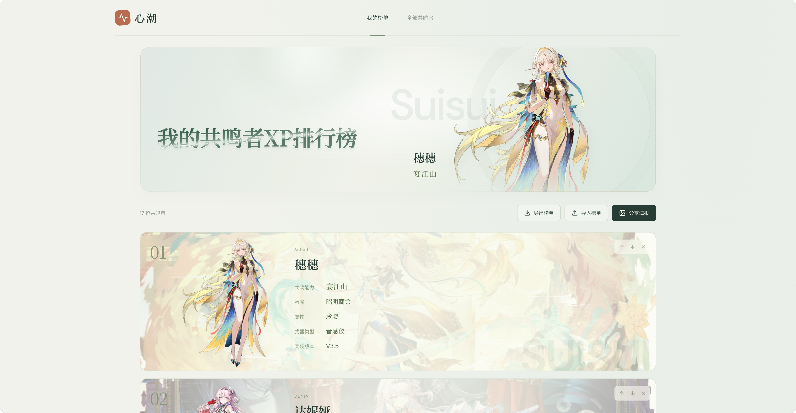
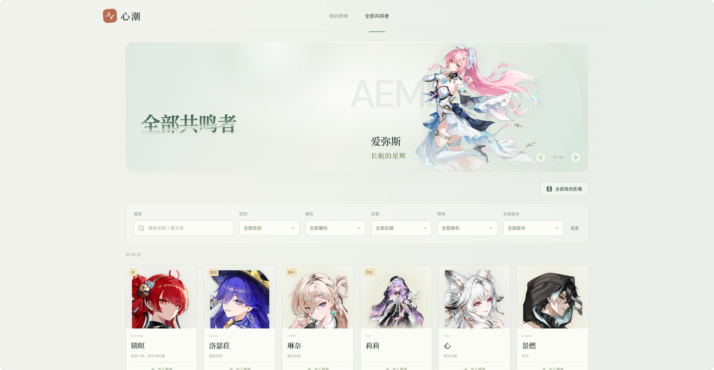
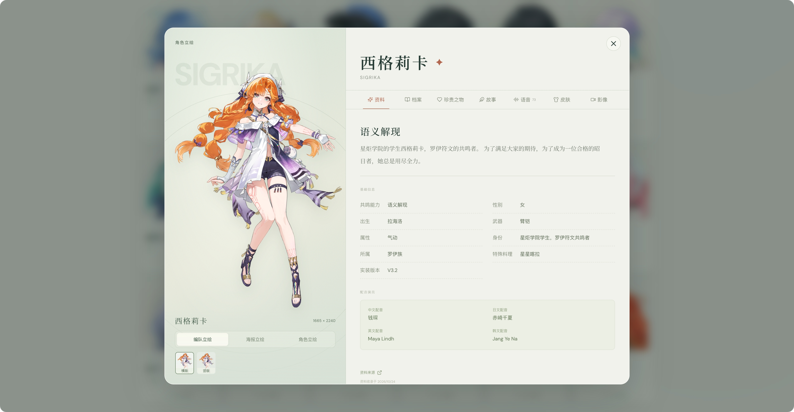
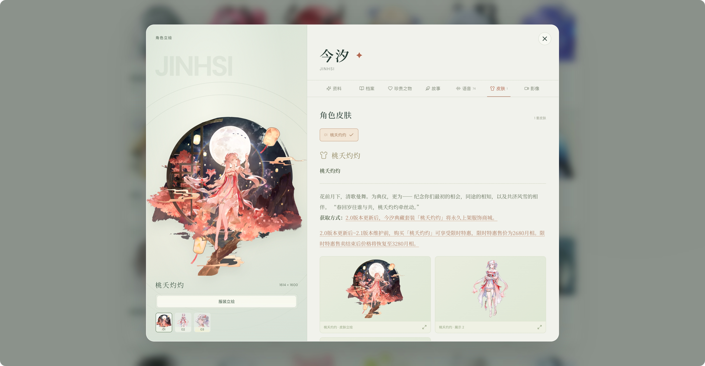
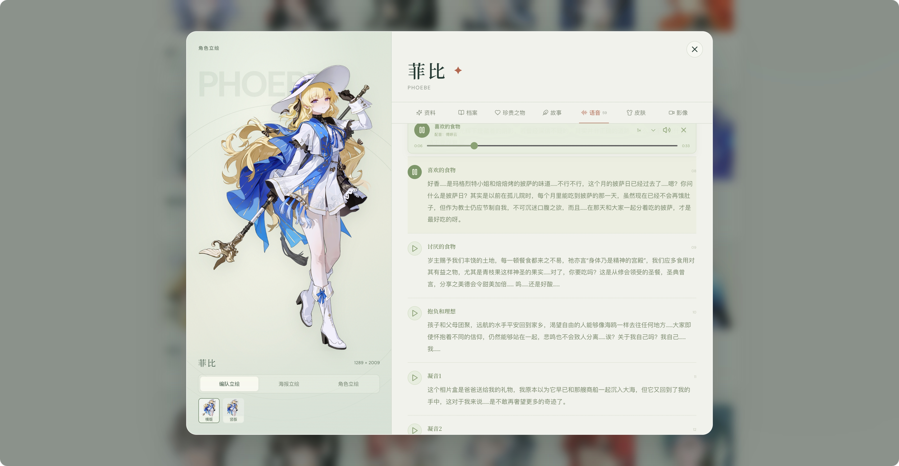
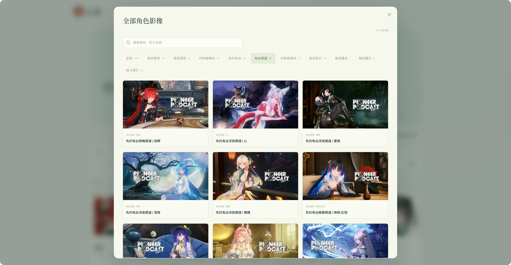
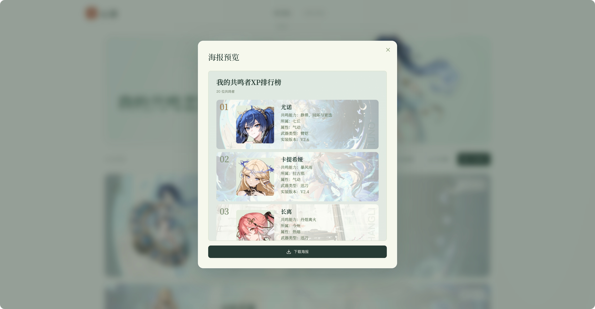
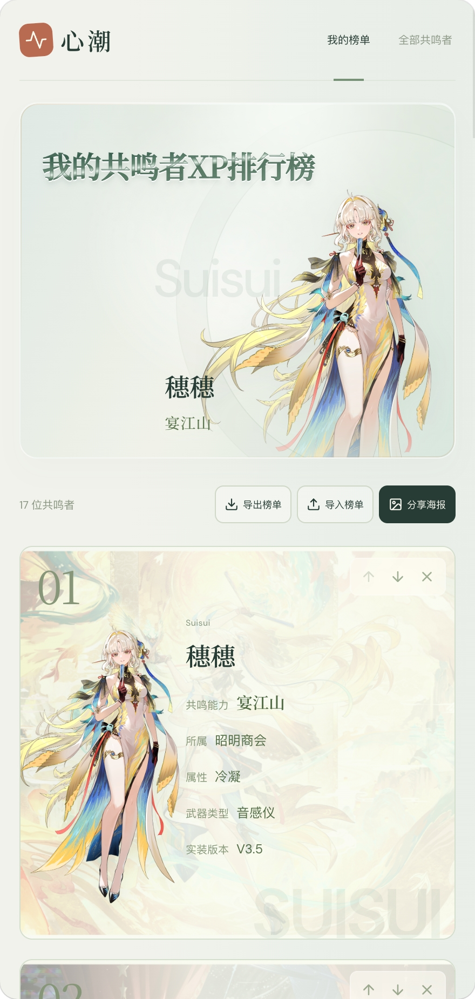
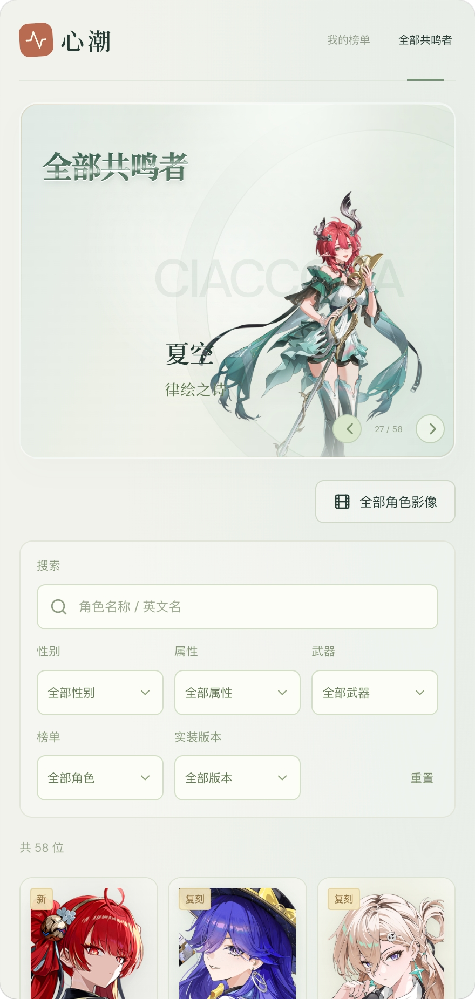
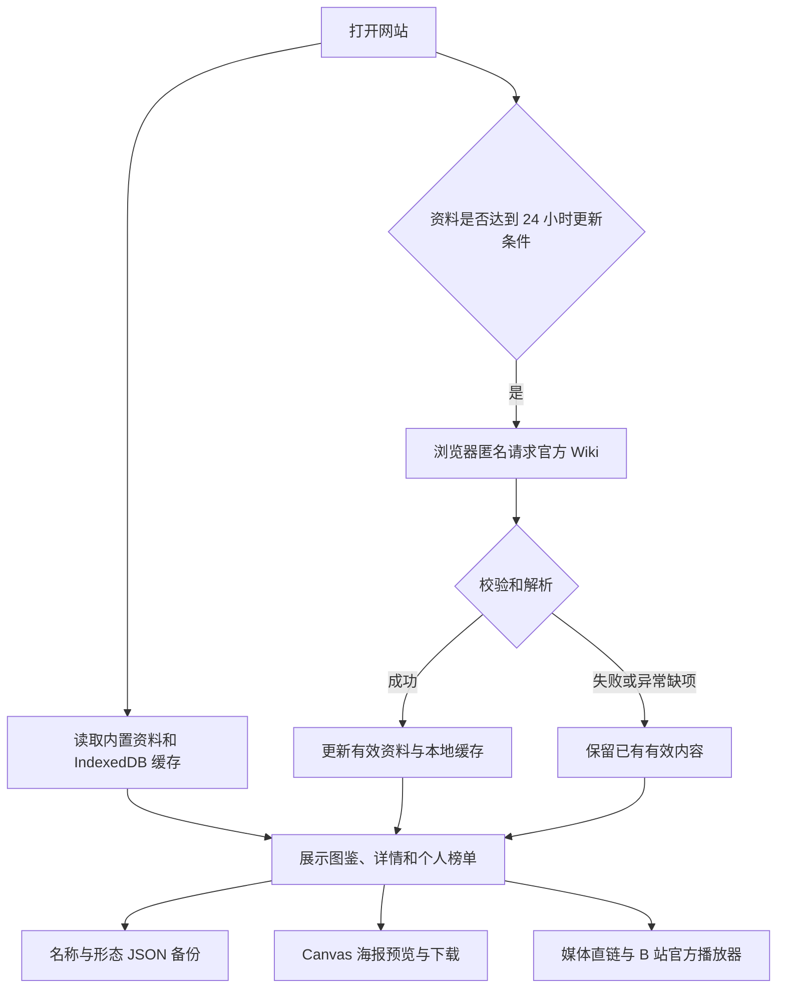

# 心潮 · 共鸣者XP排行榜

一个为《鸣潮》玩家制作的角色 XP 排行榜。支持挑选共鸣者、拖动排序、阅读角色资料，再把自己的榜单导出为海报。



[功能](#功能) · [界面预览](#界面预览) · [本地运行](#本地运行) · [技术栈](#技术栈) · [实现原理](#实现原理)

## 功能

| 功能 | 说明 |
| --- | --- |
| 我的榜单 | 添加、移除共鸣者，整张卡片拖拽排序，也可用上下按钮调整名次 |
| 全部共鸣者 | 搜索中文名与英文名，按性别、属性、武器、榜单状态和实装版本筛选 |
| 角色详情 | 查看基础资料、编队与海报立绘、档案、珍贵之物、故事及皮肤 |
| 角色语音 | 按实际收录的语言与类型浏览、搜索和播放台词，支持进度与倍速控制 |
| 官方影像 | 在角色详情内观看相关影片，也可按类型汇总、搜索全部角色影像 |
| 分享海报 | 自动生成预览，确认后下载；固定单列布局，长榜单自动拆为多张 |
| 榜单备份 | 按角色名称与形态导入、导出 JSON，方便备份与分享 |
| 资料更新 | 打开页面时检查更新时间，达到 24 小时后尝试更新 Wiki 资料；失败保留已有内容 |

## 界面预览

### 共鸣者图鉴



### 角色资料







### 官方影像



### 海报预览



### 手机界面

<p>
  
  
</p>
## 开始使用

1. 在“全部共鸣者”中搜索或筛选角色，点击“加入榜单”。
2. 回到“我的榜单”，拖动整张卡片或使用上下按钮排序。
3. 点击立绘或角色名称，打开详细资料。
4. 点击“分享海报”，查看预览后下载图片。
5. 使用“导出榜单”保留 JSON 备份；换浏览器或设备后可导入恢复。

## 本地运行

需要 **Node.js 22 或更新版本**及 npm。克隆或下载本仓库，在项目根目录执行：

```sh
npm ci
npm run dev
```

默认开发地址：

```text
http://127.0.0.1:5173/
```

常用命令：

| 命令 | 用途 |
| --- | --- |
| `npm run dev` | 启动 Vite 开发服务，支持修改后即时预览 |
| `npm test` | 运行回归测试 |
| `npm run build` | 执行 TypeScript 检查并生成生产文件 |
| `npm run preview` | 在本地预览已构建的生产版本 |
| `npm run collect` | 维护时重新采集 Wiki 基准资料 |
| `npm run prepare:videos` | 将已核实的投稿摘要合并、分类并生成影像索引 |

预览生产版本：

```sh
npm run build
npm run preview
```

生产文件输出到 `dist/`。网站应通过 HTTP(S) 访问，不以双击 `index.html` 的 `file://` 方式运行。访客访问部署后的网址时，无需安装 Node.js 或运行 npm。

## 技术栈

| 技术 | 用途 |
| --- | --- |
| React 19 | 页面、组件和交互状态 |
| TypeScript | 角色资料、榜单、媒体等数据结构及类型检查 |
| Vite 6 | 开发服务、生产构建与静态资源处理 |
| CSS / Web Animations API | 响应式布局、玻璃文字、视差、反光及排序过渡 |
| `@dnd-kit` | 鼠标、触屏与键盘拖拽排序 |
| IndexedDB | 浏览器内的个人榜单、角色资料和更新时间缓存 |
| Canvas | 在浏览器中绘制并导出海报 |
| DOMPurify / `json-bigint` | 清理来源图文、无损处理 Wiki 长整数标识 |
| Vitest | 数据解析、缓存、备份、菜单、海报会话和播放器等回归检查 |

## 实现原理



## 资料来源与维护

| 来源 | 使用内容 |
| --- | --- |
| [库街区 · 鸣潮 Wiki](https://wiki.kurobbs.com/mc/home?bbs_clientSource=12) | 基础资料、立绘、档案、故事、珍贵之物、语音、皮肤 |
| [库街区](https://www.kurobbs.com/person-center/) | 经人工核实的社区角色头像直链 |
| [鸣潮攻略站](https://mcguide.kurogames.com/zh-Hans/) | 部分头像与图片补充 |
| [鸣潮 B 站官方账号](https://space.bilibili.com/1955897084/upload/video) | 角色宣传、预告、音乐、服饰及演示等影片 |
| [鸣潮先行公约 B 站官方账号](https://space.bilibili.com/3493090606188642/upload/video) | 电台频道、共鸣者瞬间、通讯和角色短片等 |

维护 Wiki 基准数据：

```sh
npm run collect
npm test
npm run build
```

维护影像目录时，先核对官方新增投稿并更新 `research/official-bilibili-posts.json`、`research/radio-bilibili-posts.json`；需要官方角色标签佐证时补充 `research/video-role-evidence.json`，再执行：

```sh
npm run prepare:videos
npm test
npm run build
```

来源未提供的语种、角色资料或皮肤内容不会凭空补齐。上游接口、跨域策略或内容结构变化时，仍可能需要维护解析规则和资源映射。

## 项目结构

```text
.
├── .github/workflows/       # GitHub Pages 自动发布
├── docs/screenshots/        # README 展示截图
├── public/data/             # 角色基准资料与影像索引
├── scripts/                 # 资料采集与影像索引整理
├── src/
│   ├── components/          # 榜单、图鉴、详情、语音与影像
│   ├── data/                # Wiki 解析、资源映射与浏览器存储
│   ├── hooks/               # 自动更新与个人榜单状态
│   └── utils/               # 形态分组、筛选、备份与海报生成
├── research/                # 来源调查和核验摘要
└── qa/                      # 验收记录与历史截图
```

## 声明

本项目为非官方爱好者 Vibe Coding 作品，采用 Codex（GPT 6 Astra Ultra 和 GPT 6.1 Sol Xhigh）进行开发。

角色设定、立绘、头像、语音、视频及相关素材的权利归库洛游戏及各自权利方所有。

